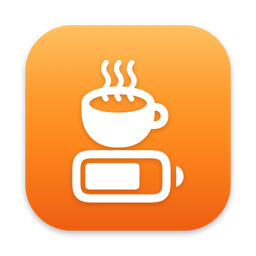
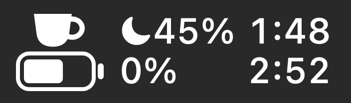
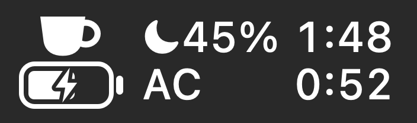
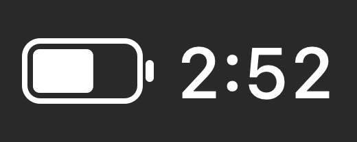
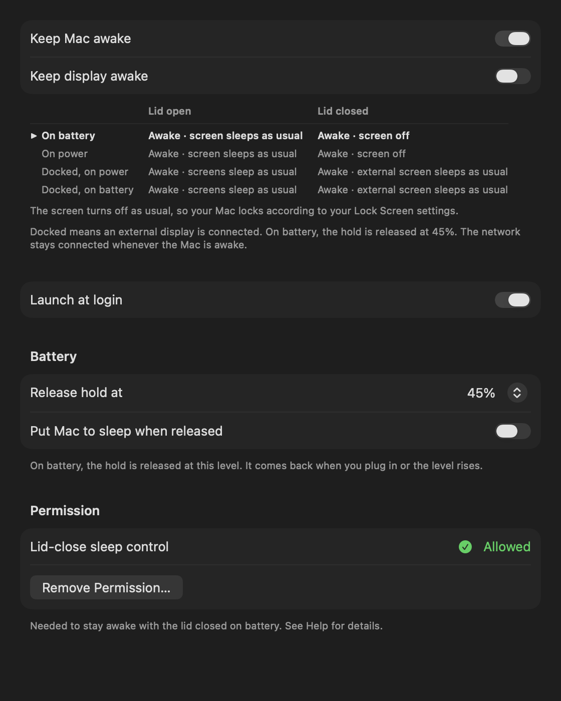
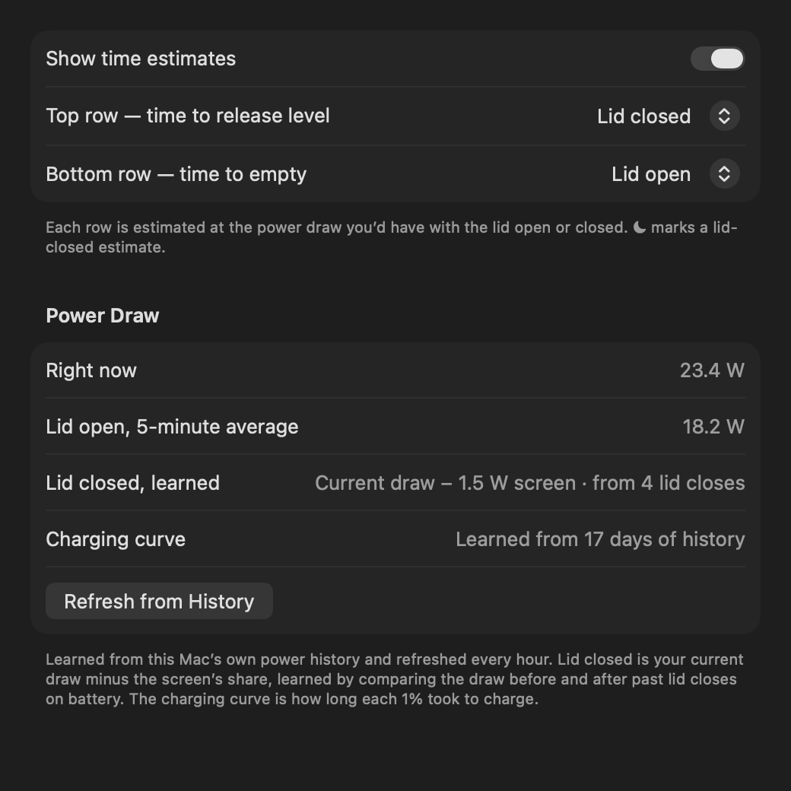
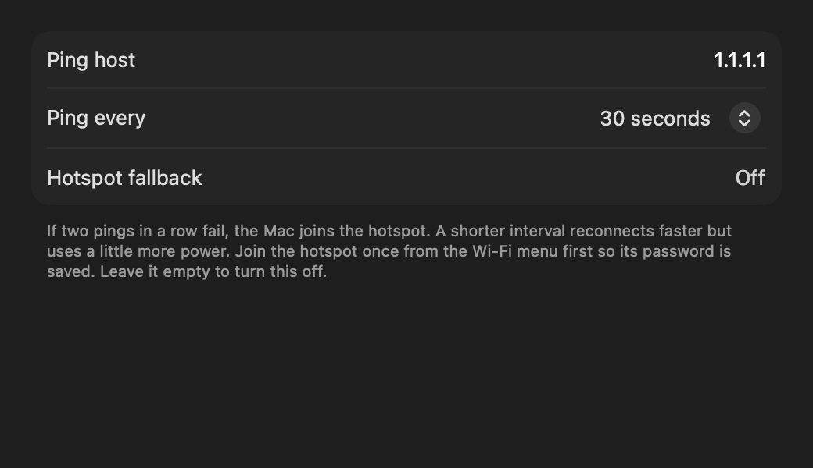
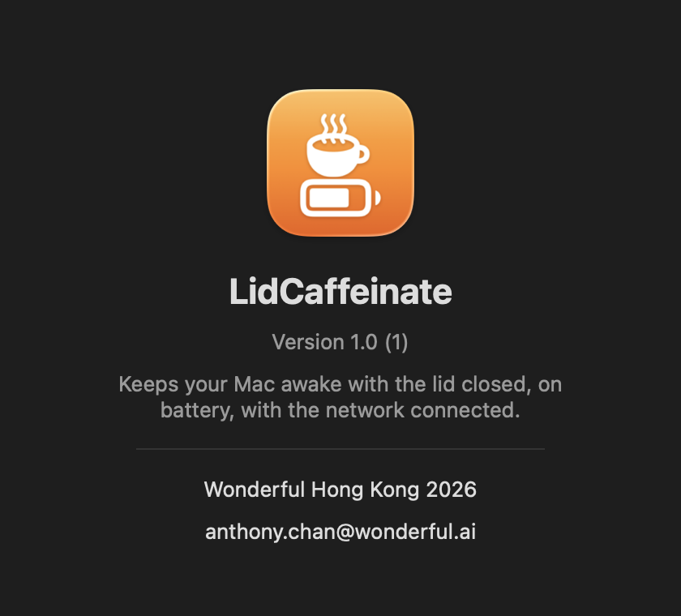
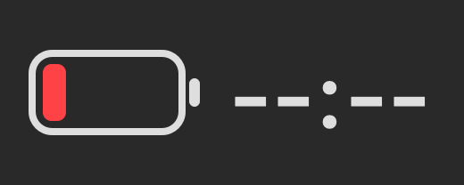

<p align="center"></p>

<h1 align="center">LidCaffeinate</h1>

<p align="center">A macOS menu-bar app that keeps your Mac awake with the lid closed, on battery, with the network connected.</p>

<p align="center">
  
  &nbsp;
  
  &nbsp;
  
</p>

Close the lid, put the MacBook in your bag, and long-running jobs, downloads, SSH sessions and agents keep going. Open the menu-bar icon to see how long the battery will last at your current power draw. Quit the app and normal sleep comes back.

## Features

- **Lid-closed, on battery.** Stays awake with the lid shut even without a charger or external display.
- **Screen really off.** With the lid closed, the built-in display is put to sleep, so it saves power and nothing is lit inside the bag.
- **Battery guard.** On battery, the hold is released at a level you choose, 45% by default. It comes back when you plug in. It can also put the Mac to sleep at that point.
- **Time estimates in the menu bar.** The top row shows the time to your release level, the bottom row the time to empty. On power, they show what you'd get if you unplugged now, and the time to full.
- **Learned power draw.** Estimates use the Mac's real power draw, measured from the battery gauge. The lid-open rate is a rolling 5-minute average. The lid-closed rate is learned while the lid is shut and kept between launches. Each row can use either one.
- **Network keep-alive.** Pings a host at an interval you set. If two pings in a row fail, it joins a fallback Wi-Fi network such as your phone's hotspot.
- **Docked aware.** With an external display, that screen keeps working, and "Keep display awake" decides whether it stays on.
- **Safe by design.** Quitting, a crash or a force-quit always turns lid-close sleep back on, thanks to a small watchdog process.
- **Native UI.** A menu with quick switches, and a standard Settings window with General, Menu Bar, Network, Help and About tabs.
- **Light.** About 0% CPU at idle and around 27 MB of memory.

## LidCaffeinate vs `caffeinate`

`caffeinate` is the command-line tool built into macOS. It's great for "don't sleep while this command runs", but it can't stop the Mac sleeping when you close the lid on battery.

| | `caffeinate` | LidCaffeinate |
|---|---|---|
| Prevent idle sleep with the lid open | ✅ | ✅ |
| Stay awake with the lid **closed on battery** | ❌ macOS sleeps on lid close | ✅ |
| Stay awake with the lid closed on power, no external display | ❌ | ✅ |
| Turn the screen off when the lid closes | — | ✅ |
| Release at a battery level, re-arm on power | ❌ | ✅ |
| Battery time estimates from real power draw | ❌ | ✅ |
| Keep the network up, fall back to a hotspot | ❌ | ✅ |
| Restores normal sleep when stopped or crashed | ✅ | ✅ |
| Needs admin rights | No | Once, for a single scoped rule |
| Interface | Terminal | Menu bar + Settings window |

Why the difference: `caffeinate` creates power assertions, and macOS ignores them when the lid closes unless an external display and power are connected. LidCaffeinate also takes those assertions, and adds the system setting that disables lid-close sleep while it's running.

## Screenshots

| General | Menu Bar |
|---|---|
|  |  |

| Network | About |
|---|---|
|  |  |

General settings shows a live table of what happens with the lid open or closed, on battery, on power and docked.

Menu-bar icon states:

| Keeping awake | Charging | Off | Released at low battery |
|---|---|---|---|
|  |  |  |  |

## Install

Requirements: macOS 13 or later on a MacBook, and the Xcode Command Line Tools (`xcode-select --install`).

```sh
git clone https://github.com/ckanthony-wonderful/LidCaffeinate.git
cd LidCaffeinate
./build.sh --install     # builds, copies to /Applications and launches
```

`./build.sh` on its own builds into `build/LidCaffeinate.app` without installing.

## Tip: replace the built-in battery icon

LidCaffeinate's menu-bar icon already shows your battery level and the time left, so you can hide macOS's own battery icon:

- **macOS 26:** System Settings → Menu Bar → Battery → Don’t Show in Menu Bar
- **macOS 13–15:** System Settings → Control Center → Battery → turn off Show in Menu Bar

## First launch: the one permission

macOS always sleeps on lid close unless the system setting `SleepDisabled` is on, and changing it needs admin rights. On first launch LidCaffeinate asks once for your password and installs this single rule in `/etc/sudoers.d/lidcaffeinate`:

```
<you> ALL=(root) NOPASSWD: /usr/bin/pmset -a disablesleep 0, /usr/bin/pmset -a disablesleep 1
```

It allows exactly those two commands and nothing else. The rule is checked with `visudo` before it's installed. You can remove it any time from Settings, then General, then Remove Permission.

Without the permission the app still prevents sleep while the lid is open.

## Security note

While a screen is kept on, your Mac doesn't lock itself, so anyone nearby could use it. This applies with the lid open and "Keep display awake" on, or when docked with the lid closed. Lock it with Control-Command-Q when you step away. With the lid closed and no external display, the screen turns off and macOS locks as usual.

## How it works

- **Power assertions:** the same ones as `caffeinate -dims`, created with IOKit. The display assertion is held only while the lid is open, or when docked.
- **Lid-close sleep:** `pmset -a disablesleep 1` while holding, `0` when released or on quit. A detached watchdog resets it if the app is force-quit or crashes.
- **Battery:** IOKit power-source APIs, plus the `AppleSmartBattery` gauge for charge, voltage, current and system load.
- **Lid state:** a power-management notification, backed up by a cheap registry check every 2 seconds.
- **Settings:** stored with `UserDefaults` under the `com.anthony.lidcaffeinate` domain.

## Project layout

| Path | What it is |
|---|---|
| `main.swift` | the whole app: AppKit menu bar plus a SwiftUI Settings window |
| `Info.plist` | bundle metadata, including `LSUIElement` so there's no Dock icon |
| `build.sh` | compiles with `swiftc`, assembles the bundle, ad-hoc signs, optional `--install` |
| `icon/make_icon.swift` | draws the app icon from SF Symbols and writes `AppIcon.icns` |
| `docs/` | README images |

Debug options, for development:

```sh
build/LidCaffeinate.app/Contents/MacOS/LidCaffeinate --battery               # numbers behind the estimates
build/LidCaffeinate.app/Contents/MacOS/LidCaffeinate --render-icons DIR      # menu-bar icon previews
build/LidCaffeinate.app/Contents/MacOS/LidCaffeinate --render-settings DIR   # Settings tab previews
```

---

Wonderful Hong Kong 2026 · anthony.chan@wonderful.ai
